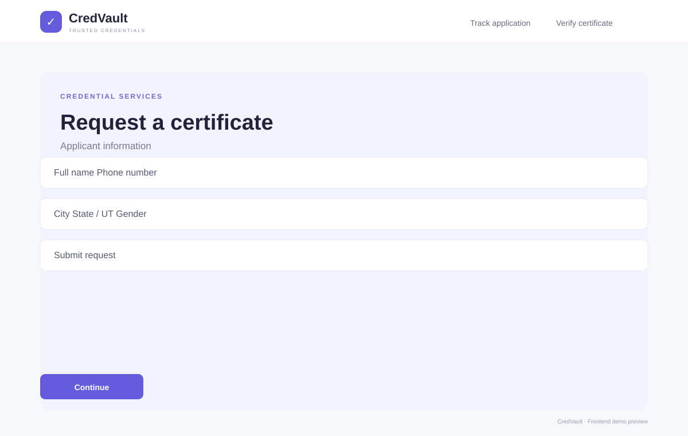
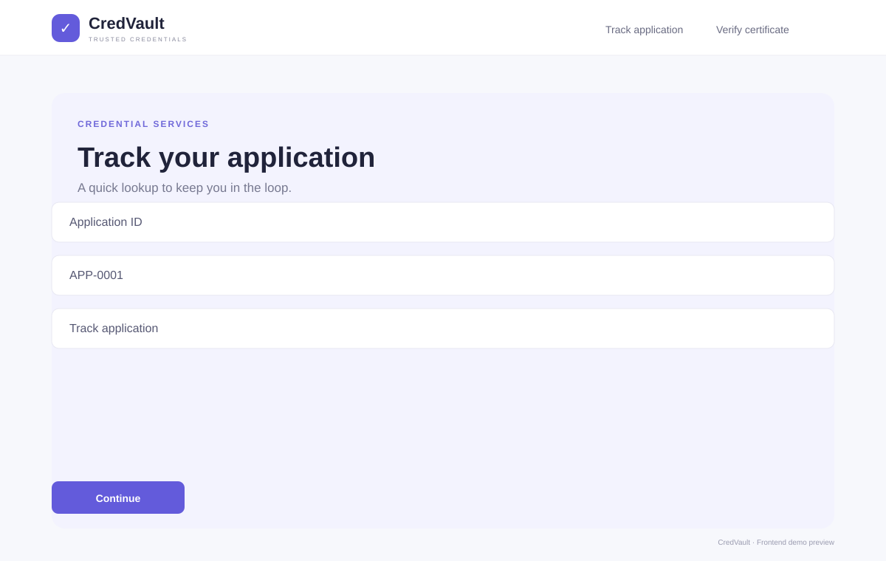
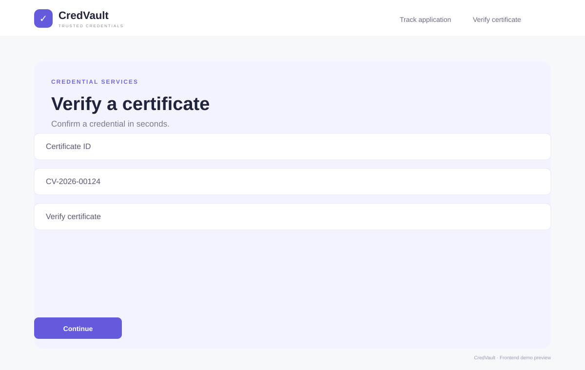
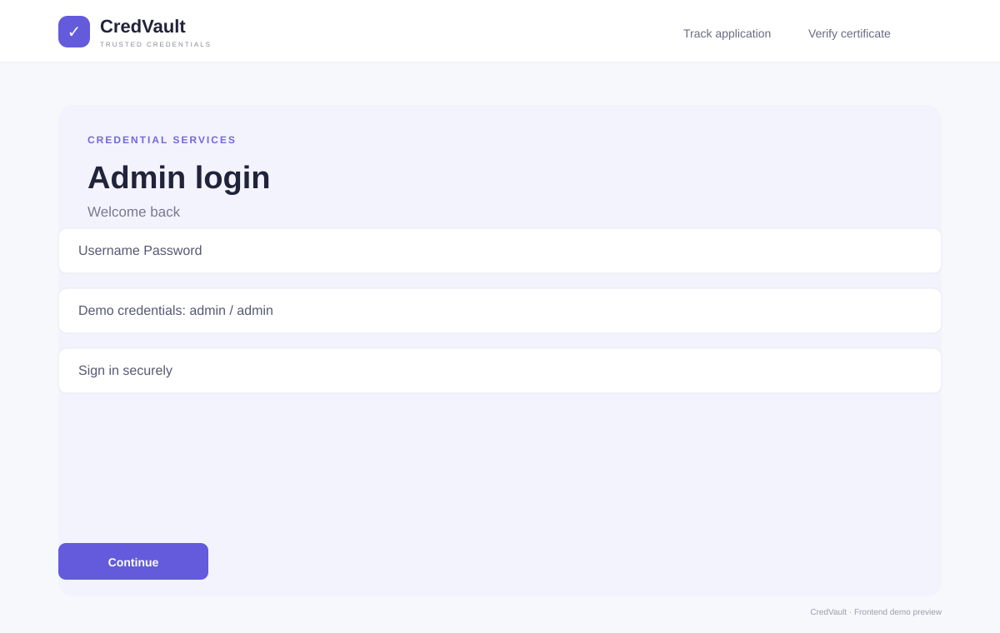
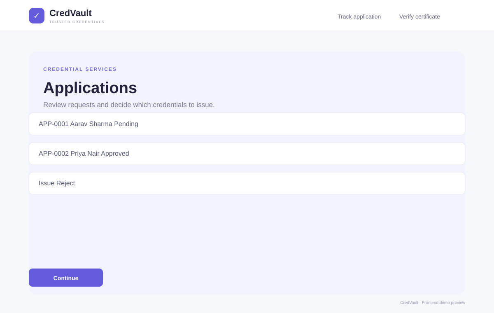

# CredVault — Certificate Issuing & Verification Platform

A responsive frontend prototype for the ELEVATE SDE internship task. Built with React + Vite and Lucide icons. This task intentionally uses dummy data only: no backend or database.

## Pages implemented
- `/` — Home with Request, Track and Verify navigation
- `/request` — Certificate request form, state selector, validation and success/Application ID
- `/track` — Application lookup with status, applicant and submission date
- `/verify` — Certificate lookup with holder, phone, issued date and Valid/Revoked status
- `/admin/login` — Demo admin login (`admin` / `admin`)
- `/admin/applications` — Applications table with Issue and Reject actions
- `/admin/certificates` — Certificates table with Revoke action

## Run locally
```bash
npm install
npm run dev
```
Open the URL printed by Vite (usually `http://localhost:5173`).

Production build:
```bash
npm run build
npm run preview
```

## Demo IDs
- Application: `APP-0001` (Pending), `APP-0002` (Approved), `APP-0003` (Rejected)
- Certificate: `CV-2026-00124` (Valid), `CV-2026-00098` (Revoked)

## Screenshots
These page previews are embedded below and included in `public/screenshots/`. For browser-captured screenshots after running locally, replace these SVG previews with PNG captures of the same routes.

| Page | Preview |
|---|---|
| Home |  |
| Request certificate |  |
| Track application |  |
| Verify certificate |  |
| Admin login |  |
| Admin applications |  |
| Admin certificates |  |

## Notes
- Admin demo login is frontend-only and is not security/authentication.
- Records are stored in React state for the current browser session and reset on refresh.
- No API calls or persistent storage are used.
